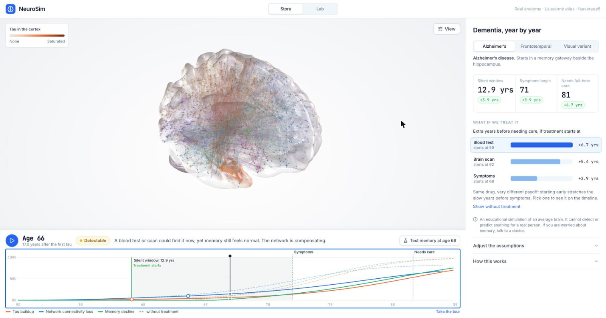

# NeuroSim

An interactive brain simulator in the browser. It runs a small spiking neural network and a whole-brain model on real human brain anatomy, and it uses them to tell one story well: how a dementia spreads through the brain over decades, and why catching it early matters.

> **This is an educational simulation, not a medical tool.** It models an average brain built from group data. It cannot detect, diagnose or predict anything for a real person.



## What you can do

**Story mode** (opens by default). Follow Alzheimer's disease, frontotemporal dementia or posterior cortical atrophy from the first misfolded protein at age 50 to needing full-time care. A short guided tour runs on first visit. You can:

- scrub a 35-year timeline and watch tau spread across a real cortex while neurons in the simulation die
- see the gap between "a test could find it" and "symptoms appear" (about 9 years for typical Alzheimer's in this model)
- start a treatment at a blood test, a brain scan or symptoms, and compare the extra years before needing care
- run a memory, speech or vision task on the damaged spiking network at any age

**Lab mode.** Hands-on tools: run tasks through the network, place lesions or strokes, change neurotransmitter levels and drugs, inspect single neurons, and fit the whole-brain model to real resting-state fMRI.

## What is real and what is modelled

The app ships this section as a page of its own at `#/evidence`, with the licences, the source links and the live model scores. The summary below is the same material.

This is the most important section. Some of what you see is measured data, and the rest comes from models of very different quality.

| Layer | What it is | Real data or model | How good is it |
|---|---|---|---|
| Anatomy | Cortical surface (fsaverage5), 68 regions (Lausanne atlas) | **Real**, group template | Standard research templates |
| Wiring | Region-to-region connection strengths from diffusion MRI | **Real**, group average (Hansen et al. 2022) | Group data, not any one person |
| Resting activity | Which regions fluctuate together at rest (fMRI) | **Real**, derived from the Human Connectome Project | Group data |
| Receptor maps | Density of 19 neurotransmitter receptors per region, from 41 PET tracers | **Real**, group average (Hansen et al. 2022) | Group data |
| MEG band power | Relative power in 6 frequency bands per region | **Real**, group average (HCP) | Group data |
| Measured atrophy | Cortical thinning in 13 disorders (Cohen's d) | **Real**, ENIGMA case-control meta-analyses | Group data, no Alzheimer's map exists |
| Spiking network | 1,100 leaky integrate-and-fire neurons in 14 regions, placed on the real cortex | **Model**, hand-tuned | Illustrative only. Pathways and weights are set by hand, not fitted to recordings. Task scores are relative to the model's own healthy baseline. |
| Whole-brain model | 68 coupled oscillators (supercritical Hopf, Deco et al. 2017) wired by the real connectome | **Model**, fitted | Predicts real resting connectivity at r ≈ 0.40, averaging five runs to remove the sampling noise of a single noisy simulation. The wiring alone scores r = 0.43, so the model's value is letting you perturb the brain, not out-predicting the wiring. |
| Tau spread | Protein spreads along the real wiring and multiplies where it lands (network Fisher-Kolmogorov model, Weickenmeier et al. 2019) | **Model**, tuned | The order in which it reaches regions agrees moderately with autopsy Braak staging (Spearman ρ ≈ 0.39). Pointed at Parkinson's, a disease it was not built for, it reproduces ENIGMA's measured cortical thinning at r ≈ 0.42, against a median of 0.07 across all possible seed regions. |
| Disease timing | Ages of milestones | **Calibrated** | The time scale is set so typical Alzheimer's symptoms arrive about 18 years after first tau, matching cohort studies (Bateman 2012, Jack 2013). Ages are typical, not personal. |
| Symptoms | Decline of the function a network carries, buffered by cognitive reserve | **Model**, simple rule | A transparent rule, not a fitted cognitive model. |
| Treatment | Slows tau spread by a chosen amount (default 30%) | **Assumption** | Approved antibody drugs slowed decline by about 27 to 35% in trials, but they target amyloid. Applying that as slower tau spread is a simplification. |

### What this project is not

- Not a diagnostic or screening tool, and not validated on any patient.
- Not a model of any individual: there are no personal scans in it.
- Not a claim about how well any real treatment works for a given person.

## How it works

```
pipeline/ (Python, offline)            src/ (Svelte + TypeScript, in the browser)
  fetch open datasets           ──►      public/data/brain.json + cortex.bin
  build regions, wiring,                   │
  receptor maps, cortex mesh               ├─ sim/          spiking network (1 ms steps)
                                           ├─ wholebrain/   Hopf model in a Web Worker
                                           ├─ disease/      tau spread, milestones, tour
                                           └─ render/       three.js scene, cortex paint
```

There is no backend. The Python pipeline turns open datasets into two static files, and everything else runs in the browser. The whole-brain model runs in a Web Worker so the 3D view stays smooth.

## Running it

Requires Node 22.12 or newer and pnpm.

```bash
pnpm install
pnpm run dev       # http://localhost:5173
pnpm test          # unit tests (Vitest)
pnpm run check     # type check
pnpm run build     # production build in dist/
```

The prebuilt data in `public/data` is included, so the app runs without Python. To rebuild the data from source, see [pipeline/README.md](pipeline/README.md).

## Data, citations and licences

The files in `public/data` are derived from the datasets below and carry their terms. In particular, they are derived from data licensed **CC BY-NC-SA 4.0**, so they may only be reused **non-commercially, with attribution, under the same licence**. The functional connectivity is derived from Human Connectome Project data, and the [HCP open-access data use terms](https://www.humanconnectome.org/study/hcp-young-adult/document/wu-minn-hcp-consortium-open-access-data-use-terms) also apply.

- Hansen JY et al. (2022). Mapping neurotransmitter systems to the structural and functional organization of the human neocortex. *Nature Neuroscience* 25, 1569 to 1581. [Data](https://github.com/netneurolab/hansen_receptors) (CC BY-NC-SA 4.0).
- Data were provided in part by the Human Connectome Project, WU-Minn Consortium (Principal Investigators: David Van Essen and Kamil Ugurbil; 1U54MH091657).
- Cammoun L et al. (2012). Mapping the human connectome at multiple scales with diffusion spectrum MRI. *J Neurosci Methods* 203, 386 to 397. Distributed via [netneurotools](https://github.com/netneurolab/netneurotools).
- Fischl B et al. (1999). High-resolution intersubject averaging and a coordinate system for the cortical surface. *Human Brain Mapping* 8, 272 to 284 (fsaverage5, FreeSurfer).
- Deco G et al. (2017). The dynamics of resting fluctuations in the brain. *Scientific Reports* 7, 3095.
- Weickenmeier J et al. (2019). A physics-based model explains the prion-like features of neurodegeneration. *J Mech Phys Solids* 124, 264 to 281.
- Raj A, Kuceyeski A, Weiner M (2012). A network diffusion model of disease progression in dementia. *Neuron* 73, 1204 to 1215.
- Schöll M et al. (2016). PET imaging of tau deposition in the aging human brain. *Neuron* 89, 971 to 982.
- Jack CR et al. (2013). Tracking pathophysiological processes in Alzheimer's disease. *Lancet Neurology* 12, 207 to 216.
- Bateman RJ et al. (2012). Clinical and biomarker changes in dominantly inherited Alzheimer's disease. *NEJM* 367, 795 to 804.
- van Dyck CH et al. (2023). Lecanemab in early Alzheimer's disease. *NEJM* 388, 9 to 21.
- Stern Y (2012). Cognitive reserve in ageing and Alzheimer's disease. *Lancet Neurology* 11, 1006 to 1012.
